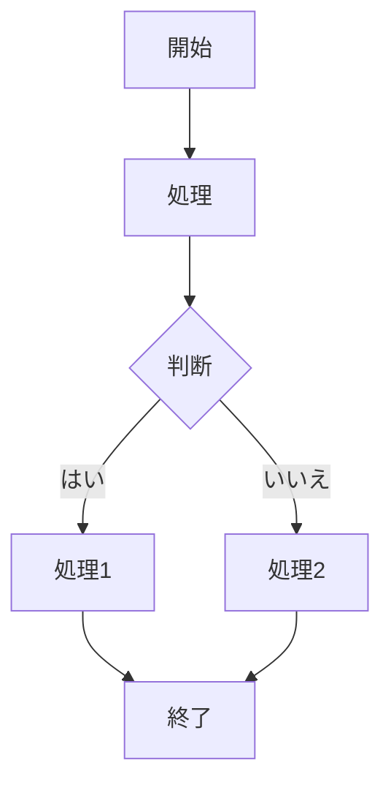

# AAAAA
## BBBB
- CCCC
- DDDD
- EEEE
## FFFF
GGGGGGGG
FFFFFFFF
1. aaaaa
1. bbbbb
1. eeeee
  1. gggg
- hhhhh
  - hhhh
    - kkkk

| ページ | URL | サーブレット |
|:----------:|:----------|---------------:|
| ホーム | /home | HomeServlet |
| 会社概要 | /about | AboutServlet |
| 製品リスト | /products | ProductServlet |

# 変数
## Javaの場合
型と変数名で表現する。例えば `Integer age = 25;` のように記述する
## JavaScriptの場合
以下のように、constやletを使い、記述する
```javascript
const name = '山田太郎';
let age = 25;
```

マークダウンを利用することにより、**素早く**構造化されたドキュ
メントを作成することができる。
---
以下は
[Wikipedia](https://ja.wikipedia.org/wiki/Markdown
)から
の引用
> Markdown（マークダウン）は、文書を記述するための軽量マーク
アップ言語のひとつである。本来はプレーンテキスト形式で手軽に書
いた文書からHTMLを生成するために開発されたものである。

